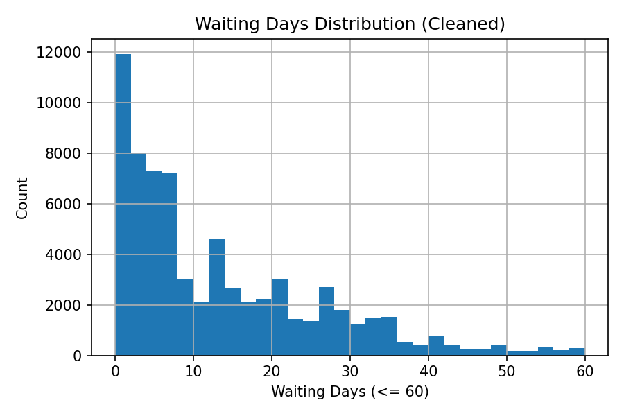
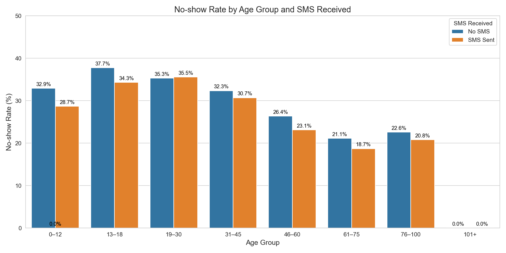
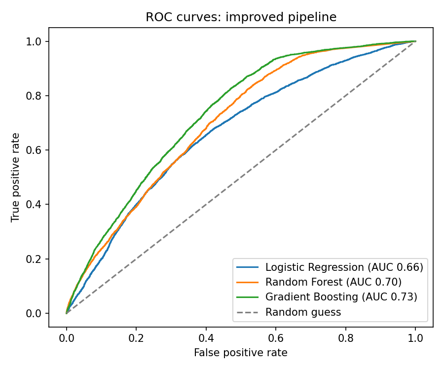

# 🏥 Medical Appointment No-Show Prediction

**ITEC 3040 Final Project, Group G, York University** · with a post-course improvement by Sam Haddad

Missed medical appointments cost clinics time and money and make other patients wait longer.
This project predicts which patients are likely to miss an appointment, so a clinic can act early with a reminder call, an SMS or smarter scheduling.

---

## 👥 Team
Jiaqi Fu · Dominic Gopalakrishnan · Suning Gu · Shushanth Gudimalla · Sam Haddad

**My contribution (Sam Haddad):**
- **Data cleaning:** duplicates, invalid ages, date parsing and waiting-time calculation
- **Streamlit app** (`app.py`): the interface that lets a user enter patient details and get a prediction
- **Post-course update** (`improved_model.py`): found and fixed a date-handling bug, added Gradient Boosting (see below)

---

## 📊 Dataset
- **Source:** [Medical Appointment No Shows](https://www.kaggle.com/datasets/joniarroba/noshowappointments), Kaggle (`KaggleV2-May-2016.csv`)
- **Size:** 110,527 appointments in Brazil (2016)
- **Target:** whether the patient missed the appointment (about **20%** did)

## 🔍 Key Insights from EDA
- **Waiting time matters most.** Patients booked for the same day missed only **4.6%** of the time; patients booked in advance missed **28.5%**.
- **SMS reminders look misleading at first.** Patients who received an SMS appear to miss *more*, because SMS was mostly sent for appointments booked far in advance.
- **Holidays did not matter.** A chi-square test found no link between appointments near a holiday and no-shows (p = 0.88).

<p align="center">
  
  
</p>

---

## 🧠 Original Course Version (`analysis.py`)
Cleaning → EDA → features (WaitingDays, IsHolidayWeek, one-hot Gender and Neighbourhood) → 3 models with class weighting → evaluation.

| Model | AUC | Precision | Recall |
|---|---|---|---|
| Logistic Regression | 0.59 | 0.34 | 0.57 |
| Decision Tree | 0.59 | 0.34 | 0.61 |
| Random Forest | 0.59 | 0.39 | 0.24 |

## 🛠️ Post-Course Improvement (`improved_model.py`)
**The bug:** `ScheduledDay` includes a time of day, but `AppointmentDay` is at midnight. Same-day appointments were therefore calculated as **−1 waiting days** and dropped as "invalid". That removed **38,567 appointments (35% of the data)**, which were exactly the patients who almost always show up.

**The fix:** compare calendar dates instead of timestamps, keeping all 110,521 valid appointments. I also added a **Gradient Boosting** model.

| Model | AUC | Precision | Recall |
|---|---|---|---|
| Logistic Regression | 0.67 | 0.31 | 0.58 |
| Random Forest | 0.70 | 0.36 | 0.26 |
| **Gradient Boosting** | **0.73** | 0.31 | 0.83 |

<p align="center"></p>

**Result:** one data-cleaning fix raised AUC from **0.59 to 0.73**. Better data beat a more complex model.

**Why AUC?** With only ~20% no-shows, a model that predicts "everyone shows up" is 80% accurate but catches no one. AUC measures how well the model ranks high-risk patients above low-risk ones, which is what a clinic needs to decide who to call first.

---

## ▶️ How to Run
```bash
git clone https://github.com/samhadd-ad/Medical-Appointment-noShow.git
cd Medical-Appointment-noShow
pip install -r requirements.txt

python analysis.py         # original course pipeline: EDA plots + trains and saves the models
python improved_model.py   # post-course version: bug fix + Gradient Boosting
streamlit run app.py       # prediction app (run analysis.py first to create the model files)
```

## 📁 Project Structure
```
├── KaggleV2-May-2016.csv   # dataset
├── analysis.py             # original course pipeline (EDA, features, 3 models)
├── improved_model.py       # post-course fix + Gradient Boosting
├── app.py                  # Streamlit prediction app
├── test.py                 # no-show rate by age group and SMS (plot)
├── models/                 # saved models used by the app
├── scaler.pkl, feature_columns.pkl
├── *.png                   # EDA, feature-importance and ROC plots
└── requirements.txt
```

## 🔮 Next Steps
- Update the Streamlit app to use the improved Gradient Boosting model
- Tune the decision threshold based on the cost of a reminder call vs. a missed appointment
- Add explainability so staff can see *why* a patient is flagged
- Check fairness across age groups and neighbourhoods

## 🧰 Tech
Python · Pandas · NumPy · Scikit-learn · Streamlit · Matplotlib · Seaborn · SciPy
